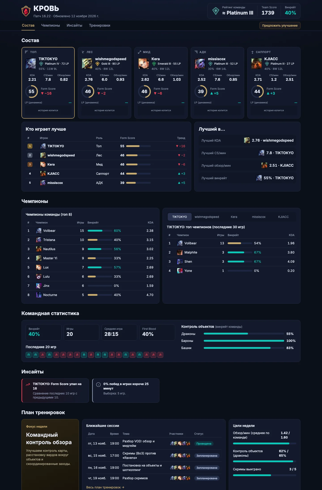

<p align="center">
  
</p>

<h1 align="center">КРОВЬ — LoL Dashboard</h1>

<p align="center">
  Дашборд команды по League of Legends: рейтинг игроков и команды, чемпионы, инсайты, план тренировок.<br>
  <b><a href="https://lol.tseitl.in">lol.tseitl.in</a></b>
</p>

<p align="center">
  
</p>

## Что на странице

- **Состав.** Пять игроков по ролям: ранг и LP, винрейт, KDA, CS/мин, обзор/мин, Form Score с трендом и динамика LP.
- **Кто играет лучше.** Лидерборд по Form Score и лучшие по отдельным метрикам.
- **Чемпионы.** Топ чемпионов команды и каждого игрока с винрейтом и KDA.
- **Командная статистика.** Винрейт, средняя длительность игры, First Blood, контроль объектов, форма за последние 20 игр.
- **Инсайты.** Короткие автоматические выводы по правилам (серии, сильные и слабые стороны).
- **План тренировок и задания команде.** Фокус недели, цели, расписание сессий и задания; полный план на странице [training.html](https://lol.tseitl.in/training.html).
- **Предложения.** Кнопка «Предложить улучшение» ведёт на форму обратной связи.

## Как это устроено

```
Riot API ──> scripts/fetch_riot.py ──> data.json ──┐
                                                    ├──> index.html + app.js  (GitHub Pages)
закрытая админка ──> training.json ────────────────┘
```

- **Сайт.** Статичные HTML, CSS и JavaScript без сборки и без зависимостей. Данные читаются из `data.json` и `training.json`, иконки чемпионов подгружаются из Riot Data Dragon. Хостинг: GitHub Pages, домен через Cloudflare DNS.
- **Данные.** Скрипт [`scripts/fetch_riot.py`](scripts/fetch_riot.py) (только стандартная библиотека Python 3) ищет игроков по Riot ID, берёт ранги (League-V4) и последние 20 игр из Solo/Duo и Flex (Match-V5), считает метрики и пишет `data.json`. Раз в сутки его запускает GitHub Actions ([`update.yml`](.github/workflows/update.yml)) и коммитит изменения; ключ Riot хранится только в секретах репозитория.
- **История LP.** Riot API историю рейтинга не отдаёт, поэтому скрипт сохраняет снимок рангов в [`history/lp.json`](history/lp.json) раз в сутки. Динамика LP на карточках появляется, когда накопится хотя бы два снимка.
- **План тренировок.** Хранится отдельно в `training.json`; правится через закрытую админку (вход по PIN), которая коммитит файл в этот репозиторий. Код админки живёт вне репозитория.

## Метрики

| Метрика | Как считается |
|---|---|
| **Rank Score** | `tier × 400 + division × 100 + LP`; рейтинг команды это среднее по игрокам |
| **Form Score** (0–100) | за последние 20 игр: винрейт 30%, KDA 25%, урон/мин 20%, CS/мин 15%, обзор/мин 10% (у Support CS заменён обзором); нормы по ролям в [`scripts/config.json`](scripts/config.json) |
| **Тренд** | Form Score последних 10 игр против предыдущих 10 |
| **Командные игры** | матчи, где на одной стороне сыграли не меньше трёх участников команды |
| **Контроль объектов** | винрейт команды в играх, где она взяла первый дракон, барон или башню |

## Локальный запуск

```bash
python3 -m http.server 8765
# открыть http://localhost:8765
```

Обновление данных вручную:

```bash
cp .env.example .env          # вписать RIOT_API_KEY
python3 scripts/fetch_riot.py --check   # проверить ключ и найти игроков
python3 scripts/fetch_riot.py           # пересобрать data.json
```

Состав, платформы и нормы метрик настраиваются в [`scripts/config.json`](scripts/config.json).

## Структура

```
index.html, style.css, app.js        главная страница
training.html, training.js           план тренировок и задания
data.json                            статистика (генерирует скрипт)
training.json                        план тренировок (правится через админку)
history/lp.json                      ежедневные снимки рангов
scripts/                             сбор данных из Riot API и конфиг
assets/                              логотип, иконки, картинка для шаринга
.github/workflows/update.yml         ежедневное обновление данных
```

---

<sub>КРОВЬ — LoL Dashboard isn't endorsed by Riot Games and doesn't reflect the views or opinions of Riot Games or anyone officially involved in producing or managing Riot Games properties. Riot Games and all associated properties are trademarks or registered trademarks of Riot Games, Inc.</sub>
